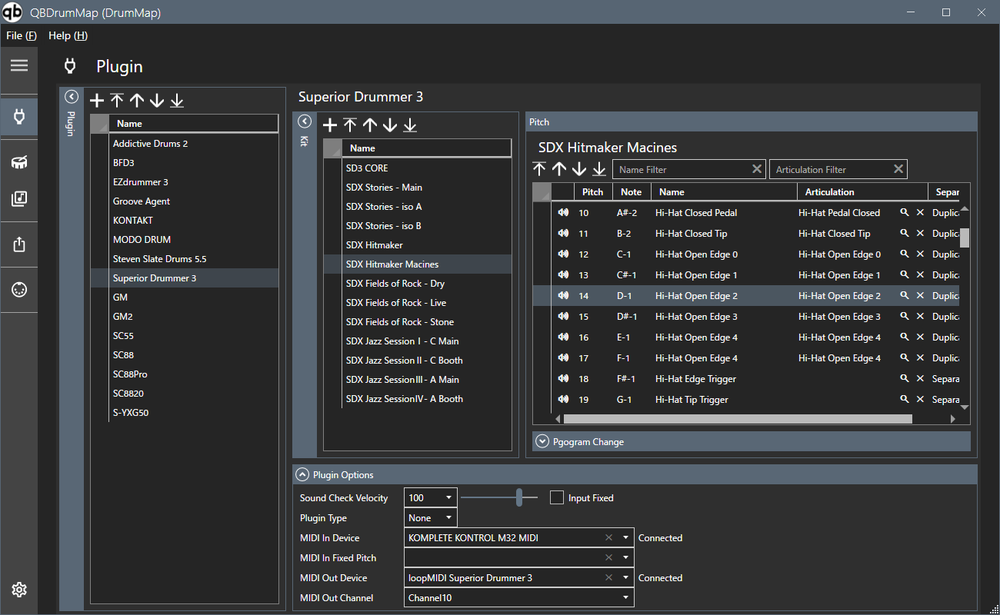

# QBDrumMap
更新者：Codex
最終更新日時：2026-10-19 11:18

[](QBDrumMap/Resources/license.txt)
[](https://dotnet.microsoft.com/)
[](https://github.com/MahApps/MahApps.Metro)
[](https://github.com/CommunityToolkit/dotnet)
[](https://www.nuget.org/packages/NAudio.Midi/2.4.0)
[](https://github.com/MinMax25/libMidi)
[](https://github.com/MinMax25/libQB)

DAW（Studio One、Cubase）で使用する **ドラムマップ編集ツール** です。  

A **drum map editor** for use with DAWs such as **Studio One** and **Cubase**.



---

## 🎥 Demo Video

QBDrumMapの基本コンセプト、画面構成、  
ドラムマップ変換・エクスポートの流れを動画で確認できます。

This video shows the basic concept, UI overview,  
and the workflow for drum map conversion and export.

[](https://youtu.be/dQjmQkXGzZQ)

---

## アップデート時の注意 | Upgrade Notice

**アップデート時の注意**：本バージョンでは設定ファイルの形式をJSONからTOMLへ変更しました。以前のバージョンの設定は自動移行されません。アップデート後はアプリケーションの設定を再度行ってください。

**Important notice for upgrading**: This release changes the settings file format from JSON to TOML. Settings from previous versions are not migrated automatically. Please configure your application settings again after upgrading.

---

## システム要件 | System Requirements

OSは **Windows のみ対応** です。  
Studio One Pro（Windows版）のシステム要件に準拠します。

Windows only.  
System requirements follow **Studio One Pro (Windows)** specifications.

---

## 言語 | Languages

標準UIは日本語と英語に対応しています。他言語は、言語パックをアプリケーションフォルダ内の `Languages/<culture-code>/` に配置すると利用できます。選択できる追加言語は、配置された言語パックによって異なります。

The built-in interface supports Japanese and English. Other languages are available when a language pack is placed under `Languages/<culture-code>/` in the application folder. The available additional languages depend on the packs installed.

**翻訳について**：日本語・英語以外の言語は機械翻訳を使用しています。そのため、一部に不自然な表現や不正確な翻訳が含まれる場合があります。内容が分かりにくい場合は、英語版の操作ガイドをご参照ください。

**Translation notice**: Languages other than Japanese and English use machine translations. Some expressions may be unnatural or inaccurate. If anything is unclear, please refer to the English version of the user guide. Translation corrections and suggestions are welcome.

---

## 開発者向けテスト | Tests for Developers

テストの実行には .NET 10 SDK 以降が必要です。リポジトリ直下の `global.json` は Microsoft.Testing.Platform を `dotnet test` のrunnerに選びます。SDKバージョンは固定しません。

```powershell
dotnet restore QBDrumMap.sln
dotnet build QBDrumMap.sln -c Release
dotnet test UnitTest\UnitTest.csproj -c Release
```

Running the test suite requires the .NET 10 SDK or later. The root `global.json` selects Microsoft.Testing.Platform for `dotnet test` without pinning an SDK version. The `UnitTest` project is part of the source repository; it is not part of the end-user application publish output.

```powershell
dotnet restore QBDrumMap.sln
dotnet build QBDrumMap.sln -c Release
dotnet test UnitTest\UnitTest.csproj -c Release
```

---

## 概要 | Overview

このプログラムは、  
**異なるドラム音源や DAW 間で共通のドラムマップを利用**できるようにするためのツールです。

音源ごとに異なるアーティキュレーションやピッチの違いを  
**統一的に管理**し、基準マップを元に変換・マッピングを行えます。

また、マップ作成時に **サウンドチェックを行える機能** を備えています。

---

This tool allows you to use **a common drum map across different drum instruments and DAWs**.

It manages differences in articulations and note pitches between instruments  
and converts them based on a reference drum map.

A built-in **sound check feature** is provided for efficient map creation.

---

## Version 2.0.0の主な変更 | Version 2.0.0 Highlights

- 未保存の編集がある状態で新規作成・別ファイルの読み込み・終了を行うと、「保存する／保存しない／キャンセル」を選べます。保存中は進行表示が出て、操作が一時的に無効になります。
- QB Drummer用CSVでは、QBD内部IDとは別の連番をArticulationに割り当てます。ドラムマップの構成や並び順を変更した後は、使用するKitのCSVを再出力してください。
- When a map has unsaved edits, creating a new map, opening another file, or closing the application prompts you to Save, Don't Save, or Cancel. A progress overlay appears and editing is temporarily disabled while saving.
- QB Drummer CSV exports assign sequential numbers to articulations independently of QBD internal IDs. Re-export the CSV files for your kits after changing the articulation structure or order.

---

## ダウンロード・インストール | Download & Installation

### 手順 | Steps

1. このページ右側の **Releases** からダウンロードしてください。  
2. ダウンロードした zip を任意の場所に展開します。  
3. フォルダ内の **`QB DrumMap.exe`** がプログラム本体です。

---

1. Download the latest release from **Releases** on this page.  
2. Extract the downloaded zip file to any location.  
3. Run **`QB DrumMap.exe`**.

レジストリは使用していません。  
不要になった場合は **フォルダごと削除**してください。

The application does not use the Windows registry.  
To uninstall, simply delete the folder.

---

## サンプルデータ | Sample Data

マップファイル **`DrumMap.qbd`** を同梱しています。

Addictive Drums 2、BFD3 など  
主要なドラム音源向けのドラムマップ、  
ドラムパーツ、アーティキュレーションが  
あらかじめ登録されています。

---

A sample map file **`DrumMap.qbd`** is included.

It contains predefined drum maps, drum parts, and articulations  
for major drum instruments such as **Addictive Drums 2** and **BFD3**.

---

## 免責事項 | Disclaimer

本ソフトウェアは無償で提供されます。  
本ソフトウェアの使用または使用不能から生じる  
いかなる損害についても、作者は一切の責任を負いません。

本ソフトウェアは予告なく提供を中止することがあります。

---

This software is provided **as is**, free of charge.  
The author assumes no responsibility for any damages  
resulting from the use or inability to use this software.

The software may be discontinued without prior notice.

---

## 📄 ライセンス | License

MIT License
